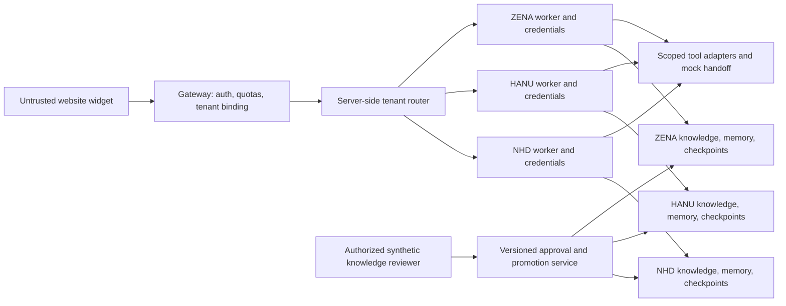

# ADR-001: LangGraph core, isolated tenant boundaries, optional modules

**Decision:** recommend architecture B for a future synthetic PoC. **Status:** Gate 1 design; implementation NOT_RUN. Evidence: [OSS dossier](OSS_DUE_DILIGENCE.md), accessed 2026-11-21. Author: Codex lead. This is a recommendation, not approval to execute Gate 2.

## Why this default

Three businesses need different knowledge, policy, tools, memory and interfaces but one maintainable core. Choose Python LangGraph OSS embedded in an application-owned service with explicit authorization and state transitions. Start with approved-document retrieval and typed preference storage; evaluate optional RAGFlow, Mem0 and Chatwoot independently. This minimizes the initial integration surface and exposes policy decisions to code review. It trades visual editing speed for custom engineering ownership.

## Common architecture and trust boundaries

All boxes are proposed logical roles. Separate worker credentials/storage domains are required; merely drawing boxes or allocating schema names is not enforcement. Gateway maps authenticated principal and allowed site configuration to a tenant. The browser, model, retrieved document and external tool never choose database credentials or override this binding. Public bot/site identifier is routing input, not proof of identity.

Per tenant: immutable config revision (prompt, locale, UI, approved tools, handoff route, corpus release), worker identity, separate database/role with no cross-tenant grants, separate object/vector collections with independently scoped credentials, cache namespace plus access-control boundary, job queue routing and checkpoint store. Prefer independent tenant databases over shared-row-only filtering for this three-tenant PoC. Same-tenant customer/session ACLs remain necessary. PostgreSQL application roles must lack superuser/BYPASSRLS privileges where row security is used. RLS cannot repair a credential that can read every tenant. Actual database/vector product selection and grants require locked-artifact review before runtime.

Application gateway and promotion service remain trusted cross-tenant components; their compromise is not eliminated by per-tenant workers. Minimize privileges, avoid loading all data credentials into graph execution, and test router/approval authorization separately. Logs/metrics may aggregate counts; raw prompts, records and credentials must not enter shared telemetry.

## A/B alternatives

| Requirement | A: Langflow | B: LangGraph (recommended) |
| --- | --- | --- |
| Authoring | Visual flows, quick inspection by engineers | Typed code/state and explicit node transitions |
| Tenant boundary | Per-tenant runtime/storage/network; never shared authoring process as security boundary | Per-tenant worker/storage credentials; namespaces alone insufficient |
| Grounding | Common retrieval adapter + citation validator in flow | Same adapter + explicit retrieve/answer/validate nodes |
| Controlled learning | External approval service; flows cannot promote knowledge | Same service; graph interrupt represents pending approval, not authorization itself |
| Change review | Version exported flow/component code; constrain arbitrary components | Code/config diffs and deterministic policy tests |
| Integration | Common widget/tool/handoff API | Same API; application does not expose framework internals |
| Cost/ops | Additional visual runtime and component surface | More engineering effort; library execution footprint still unmeasured |
| Fallback condition | Useful if visual iteration materially reduces engineering effort while all hard gates pass | Default unless measured effort/quality shows unacceptable disadvantage |

No quality/speed/cost numbers are invented. Run the future comparison using [the same evaluation protocol](EVALUATION_SPEC.md); choose only among configurations passing hard gates. If B fails isolation, fix or stop; do not select it based on aggregate score.

## Proposed graph and interfaces

Request path: authenticate → bind tenant/customer/session → load signed/pinned config revision → classify intent → retrieve approved corpus OR clarify → optional scoped mock tool → generate candidate answer → verify citation/source version and policy → answer/refuse/handoff → append minimal audit event.

Application interfaces (language-neutral contracts, not executable code):

- `TenantContext`: tenant, principal, customer/session, role, auth expiry, config/corpus revision. Construct only in trusted gateway; immutable downstream.
- `retrieve(context, query, corpus_revision)`: returns authorized document/paragraph IDs, version, scores and source excerpts. Must reject unknown tenant/version; no global fallback.
- `read_preferences(context)` / `propose_preference(context, typed_change, consent)`: customer scope only. Organization knowledge cannot be changed through this endpoint.
- `invoke_tool(context, tool_name, validated_input, idempotency_key)`: allowlisted schema, explicit action authorization, bounded output; no arbitrary URLs/SQL/shell.
- `handoff(context, consent, minimal_transcript, idempotency_key)`: routes only via server-side account/inbox mapping.
- `promote(reviewer_context, proposal_hash, expected_current_revision)`: separate staff authorization and compare-and-swap; graph/user context has no write grant.

Checkpoints must bind tenant, customer/session, config and corpus revision; replay/restore reauthorizes against current identity and revocation. Opaque IDs are not access controls. Errors expose a correlation ID and safe status, not credentials, raw source paths or another tenant's identifiers.

## Module decisions and fallback

| Module | Initial default | Admission criterion | Fallback |
| --- | --- | --- | --- |
| Retrieval | Approved small synthetic corpus via common adapter | Citation/abstention/source-version gates | Clarify/refuse; never use global search as silent fallback |
| RAGFlow | Excluded from baseline | Resolve advisory applicability and edition/license inventory; paired difficult-document gain and acceptable resource cost | Keep simpler retrieval adapter |
| Memory | Typed, consented preference records with TTL | Cross-customer and deletion/revocation tests | Session-only memory |
| Mem0 | Excluded from baseline | Positive paired memory utility; scoped deletion, poisoning and identifier tests; cost approval | Structured preferences |
| Handoff | Local mock contract | Consent, idempotency and queue/tenant tests | Safe unavailable message and retry without real notification |
| Chatwoot | CE optional later | CE feature verification, resource-account authorization, cost and staffing plan | Mock inbox during synthetic PoC |

Provider adapter must expose exact model identity and usage metadata, and separate policy from prompt text. No provider credentials or billing defaults selected now. Backup/restore, rollback and dependency refresh follow [operations](INTEGRATION_AND_OPERATIONS.md).

## Gate decision

**CONDITIONAL GO for a separately approved, bounded synthetic Gate 2 using B.** Conditions: explicit scope/spend/access approval; locked dependency/license/advisory review; enforceable isolation plan; complete frozen benchmark/oracles and independent review capacity. RAGFlow remains excluded until its advisory uncertainty is resolved. Gate 1 does not establish that the platform is secure, accurate, affordable or production-ready.
