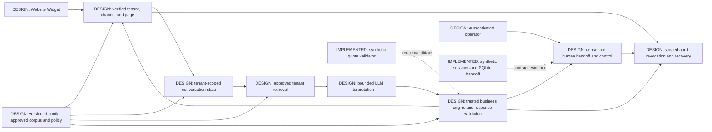

# NHD-first MVP architecture — ADR-002 (proposed)

Date: 2026-11-23. Author: Codex lead. Authority: [Issue #59](https://github.com/kha997/ai-chatbot/issues/59). Baseline: [6243aa7806b9209e3df810fbe34f1dab7bc51a40](https://github.com/kha997/ai-chatbot/commit/6243aa7806b9209e3df810fbe34f1dab7bc51a40). **Research only; Architecture Acceptance pending.** Read the [Owner memo](NHD_MVP_OWNER_59.md), [costs and gates](NHD_MVP_COST_ROADMAP_59.md), [source ledger](NHD_MVP_SOURCES_59.md), and [review record](reviews/ISSUE_59_ARCHITECTURE_REVIEW.md).

## 1. Assessment and default

The repository has a useful, small deterministic safety core and reproducible synthetic examples. It is not yet an AI chatbot. There is **no LLM conversation, real RAG corpus, real identity, embeddable website widget, or production delivery**. The accepted 73 Python tests and earlier Owner preview acceptance of 5/5 concern synthetic behavior only. They do not measure Vietnamese answer quality, injection resistance of an LLM, commercial conversion, uptime or production security.

Recommend a **Python modular monolith with an explicit bounded state machine**, application-owned authorization, approved structured catalog plus small lexical RAG, and a provider adapter initially targeting **`gpt-5.4-mini-2026-03-17`** after a separate spend/data approval. Preserve the deterministic quote oracle; keep price calculation and business authority outside the model. Use SQLite only for the future local synthetic slice; migrate to a dedicated NHD PostgreSQL database and durable identity before a real-data pilot. No LangGraph, Langflow, RAGFlow, Mem0 or Chatwoot service is mandatory for this first slice.

This is an engineering recommendation, not a measured winner. ADR-002 proposes a narrower NHD-first default in place of [ADR-001's LangGraph default](ARCHITECTURE.md) **only for this MVP**; ADR-001's security principles and original three-tenant A/B benchmark remain valid research. ADR-002 takes effect only after Architecture Acceptance. No existing document or test is retroactively relabeled as an MVP pass.

## 2. Accepted codebase and reuse map

All paths below refer to the baseline above. Whole-tree inventory included scripts, tests, fixtures, assets, CI and research/qualification receipts. Product modules and their test contracts were inspected directly; legacy CLI experiments were examined for architectural separation and authorization, not requalified or line-by-line security-audited. This is an architecture review, not a comprehensive vulnerability audit.

| Component / evidence | What exists and was tested historically | Reuse decision and gap |
| --- | --- | --- |
| [quote_validator.py](../scripts/quote_validator.py), [validator tests](../tests/test_quote_validator.py) | Pure standard-library function; exact Decimal arithmetic, positive whole quantity, tenant/source/version/status/time/citation checks; no I/O | Reuse core invariant and oracle. Caller still supplies trusted context/catalog/clock. Synthetic SKU/source patterns, single-item formula `max(qty*price, minimum)`, VND-only and no tax/shipping/rounding policy are not a real catalog engine. Bound raw input before calling. |
| [quote fixtures](../eval/quote_acceptance.json), [schema](../eval/quote_acceptance.schema.json), [tests](../tests/test_quote_acceptance.py) | 22 fixture cases, 3 positive totals and 19 clarify/refuse cases; tests implement the used schema keywords | Reuse regression seeds, not real SKU/price data or a general JSON Schema validator. New natural-language held-out corpus and independently authored oracles needed. |
| [quote_handoff.py](../scripts/quote_handoff.py), [tests](../tests/test_quote_handoff.py) | Consent, mock queue, scoped duplicate suppression, delivery/confirmation proof; only clarification offers handoff | Reuse state semantics/tests. Low-level caller-supplied staff/context are trusted, not public authentication. New MVP must permit explicit human request and safe unavailable/unknown cases without exposing refused private content. No external transport or useful lead transcript exists. |
| [quote_sessions.py](../scripts/quote_sessions.py), [tests](../tests/test_quote_sessions.py) | Server-issued opaque handles, fixed role/tenant, monotonic expiry, revocation lock, same-session ownership, bounded canonical fixture inputs | Reuse deny-first API pattern and adversarial cases. `issue/revoke` are trusted Python setup; actor string is not identity. One synthetic catalog entry per tenant and fixed valuation date. Memory-only authority is not distributed/session recovery. |
| [quote_sqlite.py](../scripts/quote_sqlite.py), [tests](../tests/test_quote_sqlite.py) | Atomic ticket+consent, unique replay key, FULL sync, rollback, current staff proof, 24h consent expiry, cap 1,000 tickets/tenant, support continuity after process restart | Reuse transaction/idempotency tests and minimal records. Shared local file, trusted OS/clock, no production key management, purge job, migrations, outbox/ack protocol, tenant DB credentials or customer recovery. Capacity cap counts retained rows; expiry is not deletion. Digests are not encryption. |
| [quote_preview.py](../scripts/quote_preview.py), [HTML](../scripts/quote_preview_assets/index.html), [CSS](../scripts/quote_preview_assets/style.css), [tests](../tests/test_quote_preview.py) | Curated loopback HTTP forms, static assets, escaping/CSP, origin/host/input checks; 7 HTTP tests | Reuse labels/journey evidence. It calls low-level mocks, not SessionQuotes/SQLite; shared tenant selector and process token are not real sessions. No natural-language input, streaming or embedding. Do not publish this server. |
| [CI](../.github/workflows/quote-acceptance.yml) | Hosted Linux quote-only suite; pinned checkout action, read-only contents permission, five-minute timeout | Preserve as regression baseline; no deployment pipeline, production scan, restore proof or AI evaluation. No dependency lock/SBOM for a future service exists. |
| [evaluation](EVALUATION_SPEC.md), [security/memory](SECURITY_AND_MEMORY.md), [operations](INTEGRATION_AND_OPERATIONS.md) | Design-only 348-case blueprint, three JSON examples, hard gates, promotion/rollback and widget/API contracts | Reuse requirements and evidence format. Full 348 records, RAG harness and measured scores do not exist. Narrow slice below is a separate milestone, not a substitute pass for all 348. |
| [watcher](../scripts/github_watcher.py), Manage-GitHubWatcher.ps1 | Read-only GitHub discovery/local queue, previously commissioned | Development operations only; never customer request handling or implicit dispatch authority. No scheduling changes. |
| `scripts/kilo*.py`, `tests/run_kilo*.py`, TLS/SSE fixtures and account qualification docs | Bounded legacy CLI qualification, mocks and consumed live-attempt records | Archive as evidence; do not import into customer service. Anonymous free coding routes and Owner subscriptions are not customer inference entitlements. |
| `tests/run_dispatcher_mock.py`, `tests/fixtures/dispatcher_mock_cli.py`, OpenCode/Ollama fixtures, Copy-OllamaStorage.ps1 and readiness docs | Mock dispatch, storage/readiness and blocked inference research | Not a product orchestrator or deployment system. Preserve spent authorizations and NO-GO. No execution in this review. |

Test accounting at PR #58: fixture 12 + validator 12 + handoff 12 + preview 7 + sessions 16 + SQLite 14 = **73** methods, some with multiple assertions/cases. This review does not claim that every legacy test passed. [Accepted PR #58 receipt](https://github.com/kha997/ai-chatbot/pull/58) and [CI](https://github.com/kha997/ai-chatbot/actions/runs/45087577206) are historical evidence; local runtime rerun is NOT_RUN under Issue #59.

Key gap: current components are separate testable seams, not an integrated customer application. Reusing them means retaining contracts and tests while replacing fixture loaders, identity and storage boundaries; it does not mean placing a model in front of the existing preview.

## 3. NHD MVP product contract

Top three priorities: (1) answer approved product/category questions accurately in Vietnamese, (2) collect missing specifications and quantities without inventing price/availability, (3) transfer a useful, consented inquiry to an accountable NHD operator.

Actors: anonymous visitor; verified returning customer only if later approved; NHD support operator; NHD knowledge/pricing approver; engineering/operations lead. Owner names the business approver and support coverage before pilot; engineering selects libraries and implements controls. HANU/ZENA remain synthetic negative-isolation scenarios, not first live tenants.

**IN:** text Vietnamese inquiry, including unaccented text and common paraphrases; approved category/product facts with source links; ask for missing item/specification/unit/quantity; one line-item nonbinding estimate only when a versioned approved pricing rule exists; explicit exclusions and validity; human request with transcript preview/consent; visible pending/accepted/unavailable/cancelled status. A price is never an order confirmation. Use session context only; no cross-session preference learning.

**OUT:** checkout/payment/orders, inventory/stock or delivery promises without approved evidence, negotiated discounts, multi-item carts, fractional quantities/unit conversion until separately specified, customer uploads/OCR, autonomous browsing/tools, ERP/CRM integration, Zalo/email/SMS, voice/images, personalized pricing, automatic knowledge promotion, customer memory, multiple live tenants and 24/7 support guarantees.

Example journey contains no real NHD facts: visitor asks for a material category → bot retrieves eligible approved facts → asks specification and quantity → visitor confirms interpreted item/unit → deterministic service returns a draft with authoritative amount/source/expiry, or says no approved price is available → visitor can request staff and approve the exact minimal summary → server queues once → only authenticated operator acknowledgement changes the status to received. Before acknowledgement say “Đã ghi nhận yêu cầu; chưa có nhân viên xác nhận”, not “nhân viên đã nhận”. On failure say unavailable and offer explicit bounded retry/cancel. Never invent a contact number, response time, SKU or policy.

Acceptance applies to whole behavior: correct facts and meaningful citations, no unsupported promises, correct clarification, no private data fetch or unauthorized side effect. A fluent answer with a wrong source fails. False refusal is a quality failure too. Human takeover suppresses late bot completions; staff sees source revision and the fields the visitor consented to share. Callback/contact collection is deferred until a separately approved PII design; first pilot can use an authenticated internal inbox and in-session exchange.

Required later NHD input: approved initial categories and 20–50 representative product records, units/specs/aliases; pricing publication permission and validity/rounding/tax/shipping/exclusion rules; 10–20 FAQ/policy passages; support hours/escalation owner; permitted data fields/retention; expected traffic and success definition. Counts are proposed pilot limits, not knowledge of NHD inventory. If pricing cannot be approved, deliver information and inquiry qualification only; do not infer prices from chat or web.

## 4. ADR-002 options and reversibility

| Criterion | Direct Python state machine — default | LangGraph OSS — deferred | Langflow — visual alternative |
| --- | --- | --- | --- |
| First journey | Few explicit transitions; directly wraps existing Python contracts | Useful primitives but extra state/checkpoint dependency surface | Visual editor useful for frequent flow authors |
| Persistence/human pause | Application transaction/state rows; lead owns correctness | Checkpoint/interrupt/replay facilities; still needs application authorization and idempotency | Exported flows and external authorization; additional runtime |
| Isolation | Dedicated NHD worker credentials; no model-chosen tenant | Identical external boundary; graph thread ID is not authorization | Shared process is not a tenant boundary per official security guide |
| Maintenance | Fewer moving parts; custom state migration/replay burden | Pin separately versioned packages/checkpointers, review advisories and upgrades | Secure IDE/code execution, version flows and runtime |
| Cost/quality | No framework license fee; engineering/LLM costs remain | MIT library is not a free hosted platform; relative performance UNKNOWN | MIT root scope; infrastructure/hosting terms separate |
| Trigger | Start here for bounded FAQ→clarify→quote→handoff | Reconsider when >=3 independently resumable workflows or repeated recovery logic costs >2 engineer-days per release; paired evaluation must show benefit | Reconsider only if trained flow authors demonstrate material maintenance savings with isolation intact |

Triggers are proposed engineering heuristics, not measured thresholds. LangGraph adoption must pass identical source/tenant/quote/consent gates, use exact dependency locks, and demonstrate lower recovery complexity without worse p95/cost. Never select a framework to compensate for missing authorization. Do not build a home-grown general agent engine: explicit allowlisted states, bounded calls, no planner/tool loop.

Provider-neutral boundaries: trusted `Context` (tenant/session/principal/role/expiry/config revision); `retrieve` (authorized query, release → source IDs/versions/passages); `generate` (bounded text/context → untrusted structured candidate + model identity/usage); `validate_quote` (canonical data → deterministic result); `handoff` (consent digest + replay key → state); `approve_release` (separate staff role, exact hash, expected prior revision). Public requests cannot construct trusted Context. Keep JSON contracts and immutable corpus exports separate from SDK objects. Future LangGraph nodes can call these same seams; migration may invalidate old sessions rather than replay incompatible checkpoints.

Model choice: GPT-5.4 mini has a dated snapshot, structured outputs and published rates; start with reasoning `none`, one call for slot interpretation and at most one grounded-answer call per user turn, no model tools. Its Vietnamese precision/latency is UNKNOWN until evaluated. GPT-6.1 Terra is a current alternative at higher published unit rates; evaluate only if the default misses quality targets and a new budget permits it. Gemini 3.5 Flash-Lite has lower token rates and is the cost challenger, but no NHD quality evidence; free-tier data terms are not acceptable by assumption. GPT-5 mini and Gemini 2.5 Flash have published lifecycle changes and are not new defaults. No automatic paid fallback. Codex/Qoder develop software; neither is the customer-facing inference service. See exact prices, dates and lifecycle sources in the [ledger](NHD_MVP_SOURCES_59.md).

Local Ollama/Qwen3:14B remains blocked by the historical RAM/exclusive-GPU/isolation conditions in [Issue #46](DIRECT_OLLAMA_READINESS_46.md). That snapshot is not current telemetry. We did not probe/start it. VRAM capacity alone does not establish model fit, throughput or concurrency; KV cache, context, CPU/RAM, contention and cleanup matter. A no-AI deterministic inquiry form is the cheapest safe fallback in operational complexity, but cannot satisfy the natural-language chatbot goal and must be labeled accordingly.

## 5. Retrieval, knowledge and deployment design

Start with curated UTF-8 structured records and short approved passages. Deterministic exact SKU/category/alias matching precedes lexical retrieval; retain original Vietnamese text, normalized search fields and approved aliases, and test diacritics/units. Return at most five passages within a 3,000-token evidence budget. Ambiguous candidates cause clarification; absent/conflicting/expired facts cause abstention. Search scores are not authority. Quote prices always come from canonical structured records, never retrieved prose or model arithmetic.

For the local synthetic slice, use an application-owned small index behind `retrieve`, with no embedding service. For pilot, PostgreSQL full-text search with explicit Vietnamese normalization/alias tests is the default. Do not assume its English stemming configuration solves Vietnamese. Add **pgvector plus a separately approved embedding model** only if lexical retrieval misses the frozen recall target and paired hybrid tests improve recall without leaking unauthorized material. Hosted file search is an alternative but adds provider-held corpus lifecycle/storage/tool charges. RAGFlow is disproportionate for a tiny curated corpus and retains advisory uncertainty; revisit only for approved complex documents. Mem0 is unnecessary with session-only context. Chatwoot CE can replace the inbox adapter if staffing/multichannel needs justify its extra service, edition and data obligations; not required now.

Source authority pipeline: NHD business author prepares records outside this public repository → separate authorized approver verifies exact content, price/exclusions, effective dates and publication scope → immutable content hash/release manifest → quarantine index + held-out regression → compare-and-swap active release → invalidate caches and in-flight stale jobs. Chat corrections enter an untrusted proposal queue; repeated claims or LLM confidence cannot promote policy. Rollback only to still-authorized releases; revocation/deletion tombstones override old backups. Preserve audit of approver/reason/hash/time. Initial source changes may be manual engineering releases; no admin UI is required for the slice.

Solid lines show proposed runtime flow. Dotted lines show synthetic component evidence. The [platform contracts and RTM](NHD_PLATFORM_CONTRACTS_59.md) define the reusable tenant, channel and product/service boundaries. Proposed pilot topology: one NHD application deployment, separate operator authentication, PostgreSQL 18 current security minor (18.7 observed), private database networking, encrypted backup outside the application host, TLS ingress, outbound provider allowlist and secret store. A modest 2-vCPU/4-GiB VM is a **sizing hypothesis**, not proven capacity. Same-host app+DB is acceptable only for an explicitly accepted limited pilot outage risk with tested restore. Production prefers managed PostgreSQL/PITR and redundant app instances after measured demand; no Kubernetes/microservice fleet needed. Region/data-residency, provider account and procurement remain Owner-approved matters. No infrastructure is created here.

Later tenants get separate credentials/databases/corpus/queue keys and workers; shared application code is allowed, shared business authority is not. NHD runtime cannot load HANU/ZENA credentials. Shared gateway/admin compromise is a residual high risk; isolation is defense in depth, not a claim of protection against the platform administrator.

## 6. Trust boundaries and fail-closed acceptance

Every row below is a future mandatory gate, not an implemented control claim. Security, consent and knowledge-promotion failures cannot be offset by answer scores. Test protected fetch/write traces as well as rendered text.

| ID / boundary | Required control and negative oracle | Current gap / accountable role |
| --- | --- | --- |
| T1 website→tenant | Server map site to NHD; reject unknown/inactive site and tenant override. Origin/CORS supplemental only. Cross-tenant request must cause zero foreign reads. | No real gateway; lead |
| T2 visitor/session/customer | Short-lived secure HttpOnly cookie or equivalent scoped token; CSRF, expiry/revocation and per-session ACL on all routes/resume. No customer history by actor string. Persist server-side session ownership across restart; expired/lost access requires separately verified recovery, never name matching. | Ephemeral authority; lead/security reviewer |
| T3 staff/recovery | Separate operator login with MFA, server-bound role/tenant; fresh auth for promotion. Recovery must verify authority, rotate tokens, audit, and permit lawful consent withdrawal after restart without exposing ticket existence. Lost anonymous credential → no history disclosure; documented support verification route before real data. | No real login/recovery; lead + business privacy owner |
| T4 retrieval/source | NHD-only DB role/index; ACL before fetch; active version, validity and tombstones checked again before output. Inject foreign doc IDs, stale caches, forged citations; expect no fetch/answer. | Fixture trust only; lead |
| T5 model/prompt | Treat user/retrieved instructions as data. No shell/URL/SQL tools, no tenant/price/consent fields accepted from model. Validate closed schema, byte/token limits and citation membership; semantic support independently evaluated. Malicious source must not change policy or disclose canaries. | No model; lead/reviewer |
| T6 price authority | Only exact approved record, authoritative current time and business-approved unit/rounding/exclusions. Revoke/expire source during generation → discard price; recompute only with newly approved data. Zero invented price/stock/order claims. | Fixed fixture date/rules; NHD pricing approver + lead |
| T7 PII/consent | Preview exact summary and purpose; explicit action bound to payload hash/scope/tenant/expiry. Changed payload requires consent again. Withdrawal blocks reads/send and cancels pending work atomically. Consent is not blanket legal basis. | No real transcript/PII lifecycle; privacy owner |
| T8 replay/queue | One transaction for consent/ticket/outbox; scoped replay key+payload hash. Worker rechecks auth/consent/revision, leased jobs, bounded retry, idempotent receiver/event dedupe. At-least-once transport, no claim of exactly-once network delivery. Crash before/after send/ack must converge without duplicate customer actions. | SQLite persists local rows only; lead |
| T9 human events | Authenticated staff actions; any future webhook signature, timestamp/nonce and tenant-account mapping checked. Duplicate/out-of-order/stale events cannot accept a different ticket. Human takeover epoch suppresses late bot replies. | Process-local proof/mock inbox only; lead |
| T10 abuse/cost | Reserve worst-case call budget atomically before dispatch; per-session and tenant quotas, bounded context/output/deadline, no automatic provider fallback. Unknown usage blocks further dispatch until reconciled. Flood and concurrent reservation tests cannot exceed authorized envelope. | No model budget gateway; operations lead |
| T11 audit/storage | TLS, encrypted disk/backups, separate secret access, least-privilege roles; raw prompts/PII absent from shared telemetry. Append restricted events with correlation, release/model/usage/state (not bearer tokens). Proposed transcript TTL 7 days, audit 30 days, backup 30 days need privacy approval. | SQLite file/host trusted; no retention purge or encryption setup |
| T12 restore/deletion | Tombstone first, purge active/derived copies, exclude from in-flight contexts; restore applies latest tombstones before serving. Revoke→backup restore→retry must not resurrect consent or knowledge. Test RPO <=24h/RTO <=60min for pilot; production tighter targets below. | No restore drill; operations + independent reviewer |
| T13 promotion | Separate approver, exact diff hash and expected release; stale/replayed/self-approval denied; runtime lacks promotion credentials. Zero unapproved chat-to-policy changes and zero unintended regression. | Design only; knowledge owner + lead |

A citation allowlist proves identifier integrity, not that the text supports the claim. Do not promise a deterministic validator catches every hallucination. Limit answer scope, prefer templated authoritative price fields, independently grade grounded claims, and require abstention when evidence is insufficient. No raw speculative streaming before validation in the first slice.

PostgreSQL row policies can supplement customer ACLs; use non-owner/non-superuser roles without BYPASSRLS and test actual grants. They do not replace separate tenant credentials. The synthetic SQLite application predicate is not equivalent to database-enforced multi-tenant isolation.
